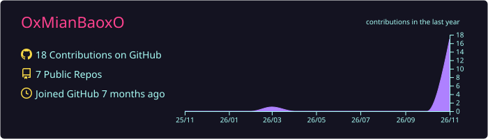
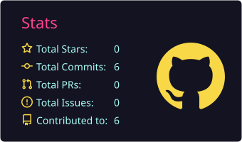
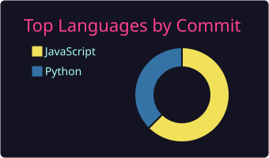

<!-- ⚠ 封印解除区域 · 非契约者请勿窥视 ⚠ -->

<div align="center">


<a href="https://github.com/OxMianBaoxO">
  
</a>

<br/>


</div>

---

## ✦ 降临宣言 · Declaration

```text
┌─────────────────────────────────────────────────┐
│  真名     ▸  OxMianBaoxO                         │
│  异名     ▸  漆黑的代码咏唱者                     │
│  所属     ▸  不可视境界线 · 观测者结社            │
│  魔眼     ▸  右眼 —— 可看穿一切 Bug 的真相        │
│  弱点     ▸  凌晨三点的报错 / 甜食的诱惑          │
│  宿命     ▸  以键盘为杖，改写这个无聊的世界        │
└─────────────────────────────────────────────────┘
```

> *「凡人只看见屏幕上的字符，而我看见的，是世界的源代码。」*

---

## ✦ 已习得的禁术 · Forbidden Arts

<!-- 在下方 icons= 后面替换成你真正会用的技术，可选图标见 https://skillicons.dev -->
<div align="center">


</div>

---

## ✦ 幻影剧场 · MV Works

> *「旋律是咒语，代码是魔法阵 —— 每一帧都由程序亲手绘制。」*

<table>
<tr>
<td width="50%" align="center" valign="top">
<a href="https://github.com/OxMianBaoxO/countdown-mv"></a>
<br/><b>✦ 最后一张</b>
<br/><sub>邓紫棋《倒数》MG 动画 MV</sub>
<br/><sub>Canvas 实时渲染 · 3:49 · 1080p60</sub>
<br/><a href="https://github.com/OxMianBaoxO/countdown-mv/releases/latest"></a>
<a href="https://github.com/OxMianBaoxO/countdown-mv"></a>
</td>
<td width="50%" align="center" valign="top">
<a href="https://github.com/OxMianBaoxO/dalabengba-mv"></a>
<br/><b>✦ 达拉崩吧 · 纸艺</b>
<br/><sub>周深 Live 版 纸艺 MV</sub>
<br/><sub>纯代码纸艺动画 · 4:05 · 1080p30</sub>
<br/><a href="https://github.com/OxMianBaoxO/dalabengba-mv/releases/latest"></a>
<a href="https://github.com/OxMianBaoxO/dalabengba-mv"></a>
</td>
</tr>
<tr>
<td width="50%" align="center" valign="top">
<a href="https://github.com/OxMianBaoxO/heaven-devil-mv"></a>
<br/><b>✦ 引力之城</b>
<br/><sub>邓紫棋《来自天堂的魔鬼》MV 导演版</sub>
<br/><sub>p5.js + p5.brush · 4:05 · 1080p30</sub>
<br/><a href="https://github.com/OxMianBaoxO/heaven-devil-mv/releases/latest"></a>
<a href="https://github.com/OxMianBaoxO/heaven-devil-mv"></a>
</td>
<td width="50%" align="center" valign="top">
<a href="https://github.com/OxMianBaoxO/runaway-star-mv"></a>
<br/><b>✦ 逃逸星</b>
<br/><sub>《來自天堂的魔鬼》WebGL MV</sub>
<br/><sub>全部由着色器生成 · 4:09 · 1080p60</sub>
<br/><a href="https://github.com/OxMianBaoxO/runaway-star-mv/releases/latest"></a>
<a href="https://github.com/OxMianBaoxO/runaway-star-mv"></a>
</td>
</tr>
<tr>
<td width="50%" align="center" valign="top">
<a href="https://github.com/OxMianBaoxO/world-gift-mv"></a>
<br/><b>✦ 窗花</b>
<br/><sub>王菲《世界赠予我的》MG 动画 MV</sub>
<br/><sub>Canvas 剪纸剪影动画 · 4:04 · 1080p60</sub>
<br/><a href="https://github.com/OxMianBaoxO/world-gift-mv/releases/latest"></a>
<a href="https://github.com/OxMianBaoxO/world-gift-mv"></a>
</td>
<td width="50%" align="center" valign="middle"><sub>✦ 下一卷幻影<br/>正在咏唱中……</sub></td>
</tr>
</table>

<sub>⚠ 以上均为非官方同人作品，仅供交流学习；歌曲版权归原作者及版权方所有。成片 MP4 在各仓库的 Release 中下载。</sub>

---

## ✦ 封印之书 · Sealed Grimoires

<!-- 加新项目：复制 assets/grimoire-yuxianqaq.svg 改名改字，再复制下面的 <a> 块改链接 -->
<div align="center">

<a href="https://github.com/OxMianBaoxO/yuxianqaq">
  
</a>

</div>

---

## ✦ 魔力观测 · Mana Readings

<!-- 下面的卡片由 .github/workflows/profile-cards.yml 每 12 小时自动生成到本仓库 -->
<div align="center">







</div>

---

## ✦ 结社联络 · Summon Me

<div align="center">

<!-- 想放的联系方式自己改链接，不想放的整行删掉 -->
<a href="https://x.com/yuxianQaQ"></a>
<a href="https://oxmianbaoxo.github.io/yuxianqaq/"></a>

<br/><br/>

<sub>✦ 若你读到了这里，说明你已被卷入不可视境界线。契约，就此成立。✦</sub>

</div>


